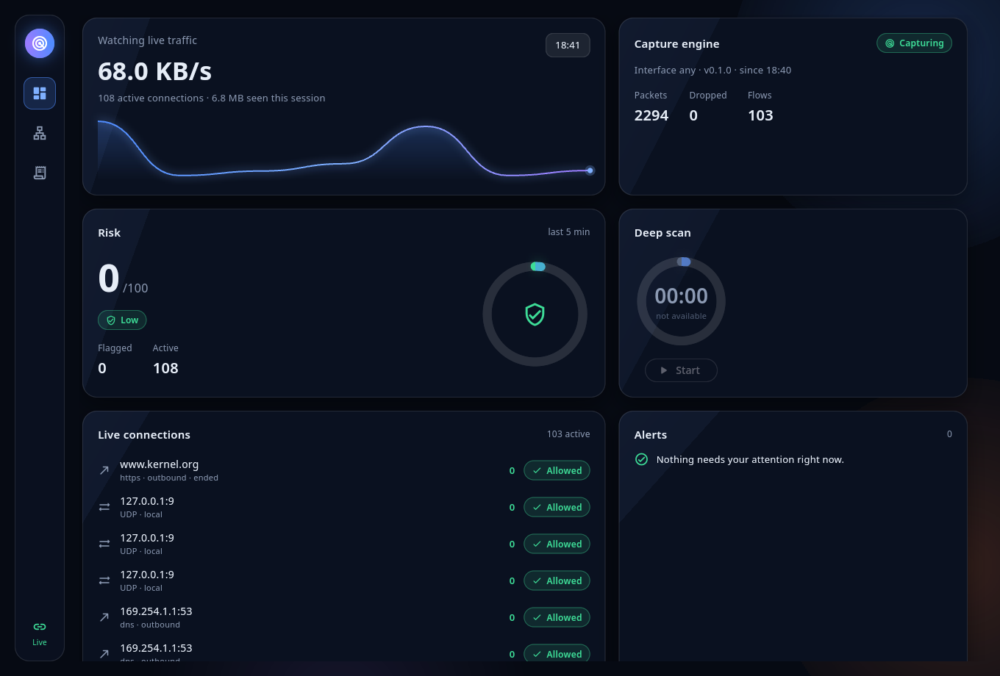
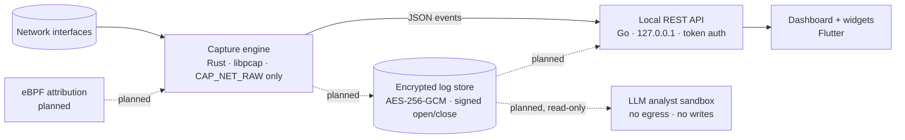

# SilentSnake

[](LICENSE)
[](https://github.com/87Supreme-cell/SilentSnake/actions/workflows/gates.yml)

**See every connection your Linux machine makes, explained in plain English, without anything leaving the machine.**


<sub>The real app on real traffic (`scripts/screenshot-app.sh`): capture engine → local API → Flutter dashboard.</sub>

SilentSnake is a fully local monitor for inbound and outbound traffic, processes, web sessions and systemd daemons. It is planned to include a real-time dashboard, desktop widgets, encrypted audit-grade logs and a sandboxed LLM analyst. This README only claims what a test, a CI run or a pentest report demonstrates.

## Status

| Component | State |
|---|---|
| Capture engine, stage A (Rust, libpcap): flows, DNS, TLS SNI, plain-English summaries | **Working.** Released as [v0.1.0](https://github.com/87Supreme-cell/SilentSnake/releases/tag/v0.1.0) (Fedora 45, x86_64), signed, with hardening fixes on `main` since |
| Local REST API (Go, `127.0.0.1:8765`): token auth, live overview, connections, event stream, risk score v0 | **Working.** Smoke-tested in CI ([`docs/api/rest-api.md`](docs/api/rest-api.md)) |
| Dashboard (Flutter, Linux desktop): risk ring, live connections, alerts, traffic, live log | **Working**, first version. Widget-tested in CI ([`app/`](app/)) |
| Process / systemd attribution (eBPF), encrypted log store, LLM analyst, widgets | Planned (see [Roadmap](#roadmap)) |

## What it shows today

The capture engine runs as your normal user. It needs only `CAP_NET_RAW` and refuses to start as root. It writes one JSON event per line, and each event carries a summary. This is real output from loopback:

```
Live capture started on interface lo with no filter.
New local UDP traffic within this machine, 127.0.0.1:56394 to 127.0.0.1:9.
New local TCP connection within this machine, 127.0.0.1:44142 to 127.0.0.1:1.
TCP connection from 127.0.0.1:44142 to 127.0.0.1:1 was reset after 0 ms: the initiator sent 74 B in 1 packet, the responder sent 54 B in 1 packet.
Capture stopped because the requested duration elapsed: 4 packets seen, 3 flows recorded.
```

On a real interface, flows are named from TLS SNI or from earlier DNS answers. Direction is classified as outbound, inbound, local or transit. Every run ends with counters that state whether the record is complete (kernel drops, packets left unprocessed). The event schema is [`docs/api/capture-events.md`](docs/api/capture-events.md).

## Run it on your machine

1. **Capture engine.** Install a release (see [Install a release](#install-a-release-fedora-45-x86_64)), or build the current `main` into an installable tarball with `scripts/release.sh fedora-45` and run its `install.sh`. The installer grants only `CAP_NET_RAW`, using `sudo setcap`; that step is yours.
2. **API.** Build it with `scripts/dev.sh bash -c 'cd services && go build -trimpath -o /work/target/silentsnake-api ./api'`, then run `target/silentsnake-api`. By default it uses `~/.local/bin/silentsnake-capture` on all interfaces and serves `127.0.0.1:8765`. On first run it creates its token (mode 0600).
3. **Dashboard.** Build it with `scripts/app.sh flutter build linux --release`, then run `app/build/linux/x64/release/bundle/silentsnake`.

## 60-second proof
_Pending. It needs the dashboard, the log store and the analyst (`scripts/demo-60s.sh`, recordings in `docs/proof/`)._

## Architecture



Solid lines are built or in progress. Dotted lines are planned.

## Threat model (summary)

From `threat_model` in [`dependencies.json`](dependencies.json):

| Threat | Mitigations in place now |
|---|---|
| Memory disclosure from hostile packets | All parsing in Rust. `unsafe` is forbidden everywhere except one reviewed FFI crate, where each use must be allowed explicitly. Parsers are fuzzed in CI and by `cargo-fuzz`; the latest decoder run was 73.7M executions with no crash |
| Privilege escalation | The engine never runs as root, holds only `CAP_NET_RAW`, and refuses extra capabilities |
| Tampered or malicious dependencies | Every dependency is pinned with hashes. `cargo-deny`, `cargo-audit` and `osv-scanner` gate every push. No new dependency without owner approval |
| Leaked secrets | `gitleaks` scans the full history and the working tree in a pre-commit gate and in CI |
| Evasion or blinding of the monitor | Red-team re-tests after every milestone (below). Drops and incomplete records are always reported, never hidden |
| Local API abuse | Listens on 127.0.0.1 only (checks the peer and the Host header too), constant-time bearer token in a 0600 file, read-only GET, strict input validation, rate limit. Proven by `scripts/smoke-api.sh` in CI and fuzzed |
| Log tampering, LLM exfiltration | Designed (hash chain, signed exports, sandbox without egress) but **not built yet** |

## Crypto design
_Planned with the log store:_ AES-256-GCM (AEAD) at rest through `aws-lc-rs`, keys sealed to the machine (TPM 2.0, otherwise the kernel keyring with a passphrase), Ed25519 / ECDSA P-256 signatures on every log open and close, a hash-chained audit log, and FIPS mode switched by config. None of this is implemented yet, and none of it is claimed.

## NIST control mapping
NIST SP 800-53 and SSDF (SP 800-218) mapping: [`docs/controls.md`](docs/controls.md).

## Install a release (Fedora 45, x86_64)

Download `silentsnake-capture-*.tar.gz` and its `.sha256` and `.sigstore.json` from the [v0.1.0 release](https://github.com/87Supreme-cell/SilentSnake/releases/tag/v0.1.0), then verify it before installing:

```sh
sha256sum -c silentsnake-capture-*.tar.gz.sha256
cosign verify-blob --bundle silentsnake-capture-*.tar.gz.sigstore.json \
  --certificate-identity "https://github.com/87Supreme-cell/SilentSnake/.github/workflows/release.yml@refs/tags/v0.1.0" \
  --certificate-oidc-issuer https://token.actions.githubusercontent.com silentsnake-capture-*.tar.gz
gh attestation verify silentsnake-capture-*.tar.gz --repo 87Supreme-cell/SilentSnake   # SLSA provenance
tar -xzf silentsnake-capture-*.tar.gz && cd silentsnake-capture-*/ && ./install.sh
```

The installer refuses root and re-checks every file against `SHA256SUMS`. It installs to `~/.local/bin` with mode 0700 and grants only `CAP_NET_RAW`, using `sudo setcap`.

```sh
silentsnake-capture -i any --stats 30                 # live, all interfaces
silentsnake-capture -r capture.pcap --local-addr IP   # replay a file (no privileges needed)
```

Releases are signed keyless with cosign in CI and carry SLSA build provenance. The binary is built twice and must hash identically. An SBOM (syft) and the build environment ship inside the tarball. See [ADR-0002](docs/decisions/0002-build-targets-packaging-fuzzing.md).

## Build from source

Everything builds in a pinned container: Fedora 45 by digest, Rust 1.99.0, Go 1.27.4, every tool pinned by version and hash. The host needs only `podman`.

```sh
scripts/dev.sh cargo build --release -p silentsnake-capture
scripts/gates.sh                       # fmt, clippy -D warnings, tests, deny, audit, osv-scanner, gitleaks
scripts/smoke-capture-loopback.sh      # non-root + CAP_NET_RAW live capture, burst check, privilege checks
scripts/fuzz.sh decode 300             # cargo-fuzz a target for 300 s
```

## Tests and pentest results

- **CI** ([`gates.yml`](.github/workflows/gates.yml)) runs on every push: all gates, the loopback smoke test and a fuzz smoke run.
- **Smoke test** asserts capture works as non-root with only `CAP_NET_RAW`, that root and extra capabilities are refused, and that three tight 20,000-datagram bursts arrive with 0 kernel drops and are all processed.
- **Red team:** a dedicated adversary agent attacks every milestone ([`docs/security/`](docs/security/)). After six re-tests of stage A, **0 critical and 0 high findings are open**. 11 are fixed, and 11 medium, 8 low and 2 info findings are open and tracked in [`findings.md`](docs/security/findings.md).
- **Measured capacity** (loopback, release build): 0 kernel drops on 100,000-datagram bursts, ~550k datagrams/s sustained, and 60k new flows/s. Above ~150k new flows/s, drops start and are reported. See [ADR-0001](docs/decisions/0001-stage-a-libpcap-capture.md).

## Roadmap

Capture stages from `capture_integration_roadmap` in [`dependencies.json`](dependencies.json):

| Stage | Goal | State |
|---|---|---|
| A | Native capture: Rust + libpcap; flows, DNS, TLS SNI, summaries | Done (v0.1.0 + hardening) |
| B | tcpdump / tshark adapters under the same schema | Next capture stage |
| C | Per-process and systemd-unit attribution with eBPF (aya) | Planned |
| D | Optional inspection of your own HTTPS (mitmproxy, off by default) | Planned |
| E | Optional Zeek protocol analytics | Planned |

Alongside those: the encrypted log store, the LLM analyst sandbox, desktop widgets and the 60-second proof recording.

## License
MIT. See [LICENSE](LICENSE).
